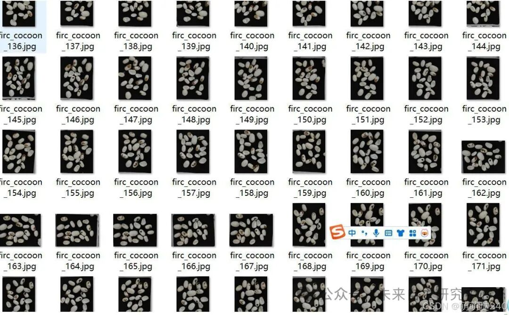
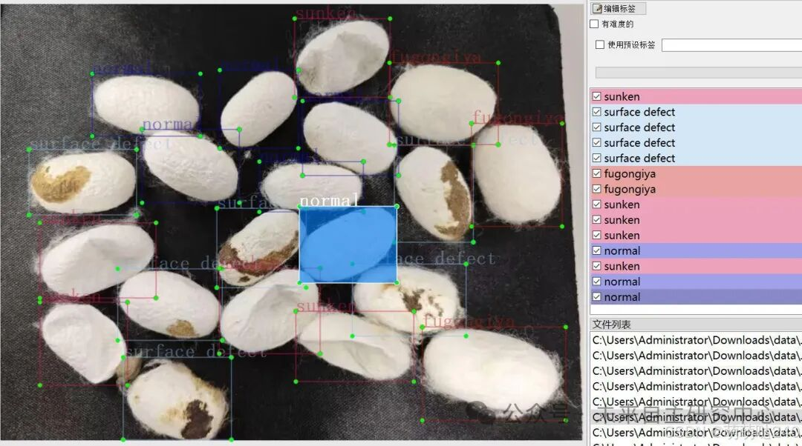

# Silkworm cocoon defect detection dataset VOC+YOLO format with 523 images in 4 categories

Dataset format: Pascal VOC format + YOLO format (txt files without split paths, only containing jpg images and corresponding VOC format xml files and yolo format txt files)
Number of images (number of jpg files): 523
Number of annotations (number of xml files): 523
Number of annotations (number of txt files): 523
Number of annotation categories: 4
Annotation category names: ["fugongiya", "normal", "sunken", "surface defect"]
Number of bounding boxes for each category:
fugongiya = 1297
normal = 1825
sunken = 2110
surface defect = 4042
Total number of bounding boxes: 9274
Labeling tool used: labelImg
Annotation rules: Draw a rectangle around the category
Important note: No guarantee is made regarding the accuracy or weights of the trained models. The dataset provides accurate and reasonable annotations only.

Image Preview:

Annotation example:

## Payment

Here is a pay link on Stripe ( https://buy.stripe.com/3cs8yP7sY87d0vu9AB ). Please contact me lonlonago@foxmail.com after funding $89, and I will send you a complete data files , thank you!

